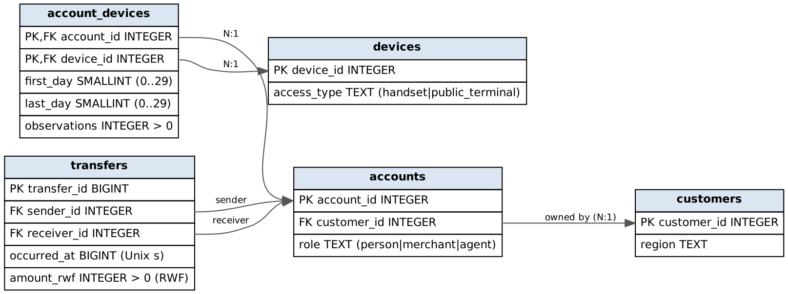
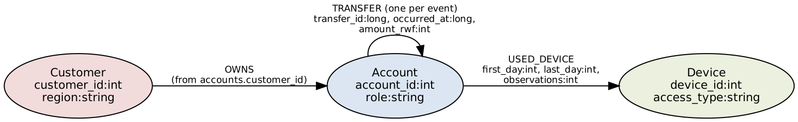
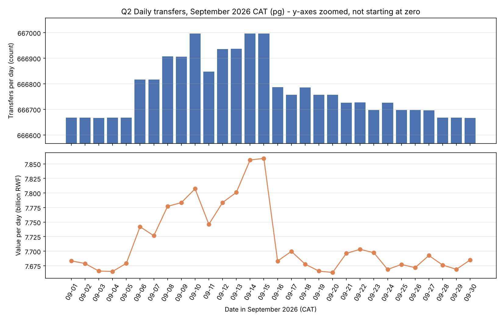
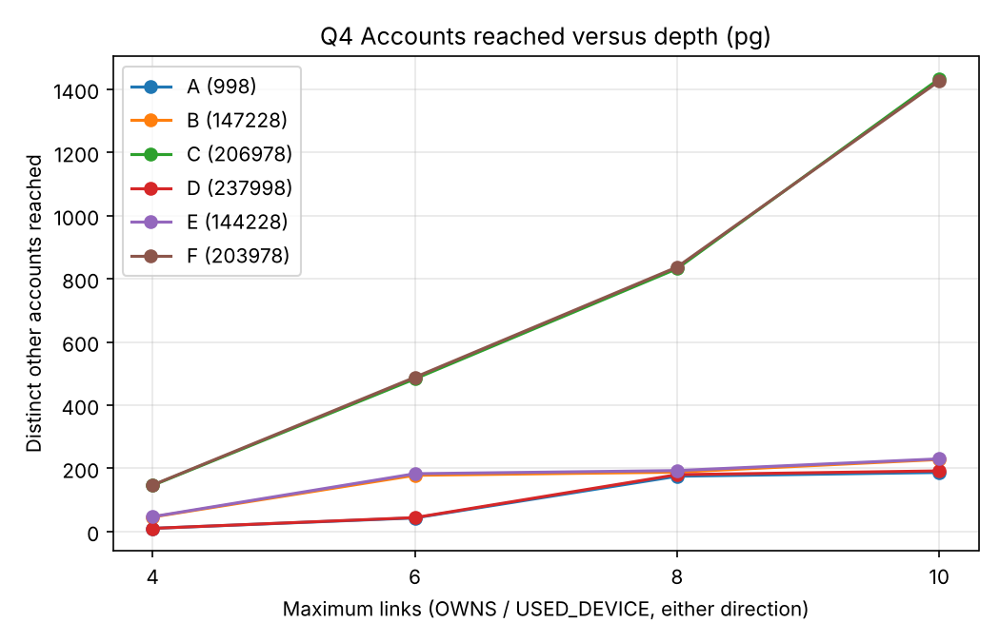
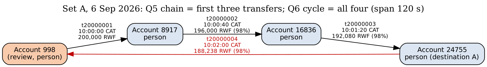
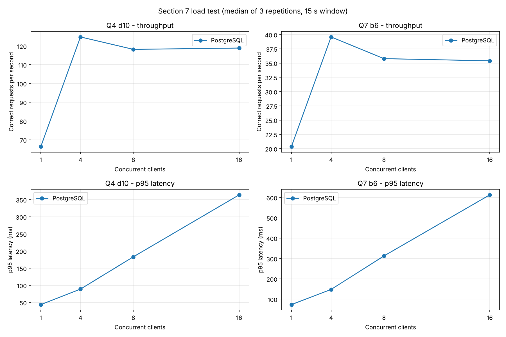
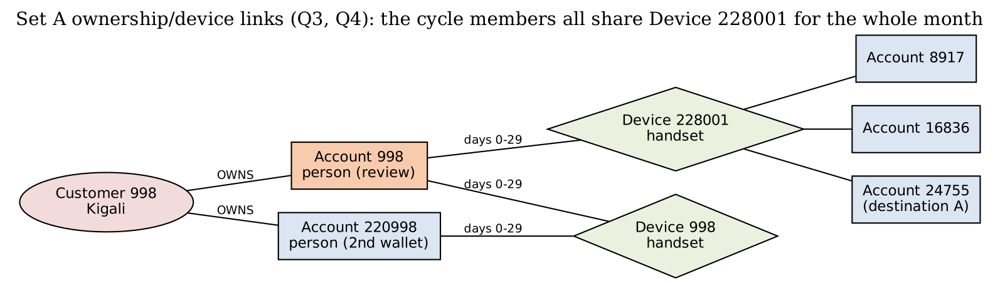

# Mobile Money Investigations with PostgreSQL and Neo4j
**Advanced Big Data Analytics – Project 2 · Group 17 · AUCA**

| Member | Student ID |
|---|---|
| Fulgence Muhirwa | [ID] |
| Uwineza Deborah | [ID] |
| Babatunde Oyedele | [ID] |

GitHub: [URL] · Submitted [date] · Models: relational (PostgreSQL 16) and property graph (Neo4j Community [version]).

> **How to finish this draft.** Everything about *query answers* below is final – the dataset is
> fixed and the answers are identical on every machine. Values in **[YOUR …]** brackets are
> machine-specific (times, sizes, load test): replace them with the numbers your runs print.
> The figures in *italics labelled "reference run"* are from our own PostgreSQL run on a
> 2-vCPU / 8 GB Linux machine and are only there so you can see the expected order of magnitude.
> Insert each 📸 screenshot where marked; reuse earlier screenshots instead of repeating them.

---

## 1 Capture the data

### 1.1 Workspace
| Item | Value |
|---|---|
| OS / CPU / RAM | [YOUR – results/environment.json] |
| Python / psycopg / neo4j driver / numpy | [YOUR] |
| PostgreSQL version, settings | [YOUR] shared_buffers, effective_cache_size, work_mem, maintenance_work_mem; TimeZone = Africa/Kigali |
| Neo4j version / edition, memory | [YOUR] heap initial/max, page cache |

📸 1.1 – step01 output: both connections, TimeZone, memory settings.

### 1.2 capture.py
`step02_capture.py` previews ten records per stream with `itertools.islice`, then streams each
generator straight into `csv.DictWriter` (no stream is held in memory), counting consumed and
written rows and logging every million transfers. Because transfers are **not time-sorted**, the
earliest/latest `occurred_at` are tracked as running min/max.

| Stream | Rows written | Expected | Seconds | CSV GB |
|---|---|---|---|---|
| customers | 228,000 | 228,000 | [YOUR] | 0.004 |
| accounts | 248,000 | 248,000 | [YOUR] | 0.005 |
| devices | 228,600 | 228,600 | [YOUR] | 0.004 |
| account_devices | 285,600 | 285,600 | [YOUR] | 0.006 |
| transfers | 20,003,300 | 20,003,300 | [YOUR] (*reference run 75.7 s*) | 0.780 |
| **Total** | **20,993,500** | 20,993,500 | [YOUR] (*77.5 s*) | **0.799** |

Transfer audit: count 20,003,300 · earliest 1,788,235,200 (2026-09-01 06:00:00 CAT) · latest
1,790,798,399 (2026-09-30 21:59:59 CAT) · sum 231,482,327,870 RWF.

📸 1.2a preview · 📸 1.2b five-stream totals and audit.

---

## 2 PostgreSQL

### 2.1 Schema


| Table | Field | Meaning and unit |
|---|---|---|
| customers | customer_id, region | customer key; one of five provinces/Kigali |
| accounts | account_id, customer_id, role | wallet key; owning customer (FK); person / merchant / agent |
| devices | device_id, access_type | device key; handset or public_terminal |
| account_devices | account_id, device_id | an observed (wallet, device) pair – composite PK, both FKs |
| | first_day, last_day | inclusive day numbers 0–29 (0 = 1 Sep 2026 CAT) |
| | observations | number of sightings in that interval (> 0) |
| transfers | transfer_id | event key (BIGINT) |
| | sender_id, receiver_id | paying and receiving wallets (two FKs to accounts) |
| | occurred_at | Unix seconds (BIGINT); shown in Africa/Kigali |
| | amount_rwf | whole Rwandan francs (> 0) |

All 17 columns are NOT NULL. Constraints: 5 primary keys, 5 foreign keys, `amount_rwf > 0`,
`observations > 0`, `0 <= first_day <= last_day <= 29`, plus role/access_type value checks.
📸 2.1 – `\d+ accounts`, `\d+ account_devices`, `\d+ transfers`.

### 2.2 Load and checks
| Phase | Seconds |
|---|---|
| `\copy` load of five files | [YOUR] (*reference 15 s; transfers 14.1 s*) |
| PK/FK/CHECK + indexes + VACUUM ANALYZE | [YOUR] (*reference 58 s*) |

Row counts and the transfer audit match capture.py exactly; roles are 240,000 person,
6,000 merchant, 2,000 agent; every constraint is `convalidated = true`.

| Size (1 GB = 10⁹ B) | Data | Indexes | Total |
|---|---|---|---|
| transfers | [YOUR] (*1.206*) | [YOUR] (*2.434*) | [YOUR] (*3.639*) |
| all tables | [YOUR] (*1.250*) | [YOUR] (*2.468*) | [YOUR] (*3.718*) |

The two covering indexes on transfers are each larger than the table data – the price of
index-only scans in both transfer directions.
📸 2.2a load timings · 📸 2.2b step04 checks, constraints, indexes, sizes.

---

## 3 Neo4j

### 3.1 Graph mapping


| Source field | Graph |
|---|---|
| customers.customer_id, region | `(:Customer {customer_id:int, region})` |
| accounts.account_id, role | `(:Account {account_id:int, role})` |
| accounts.customer_id | `(:Customer)-[:OWNS]->(:Account)` (derived owns.csv) |
| devices.device_id, access_type | `(:Device {device_id:int, access_type})` |
| account_devices.account_id / device_id | start / end of `[:USED_DEVICE]` |
| account_devices.first_day, last_day, observations | properties of USED_DEVICE |
| transfers.sender_id / receiver_id | start / end of `[:TRANSFER]` |
| transfers.transfer_id, occurred_at, amount_rwf | properties of **one TRANSFER per row** (repeated payments kept) |

### 3.2 Import
Typed headers (temporary copies; source CSVs unchanged, verified by MD5):
`customer_id:ID(Customer),region:string` · `account_id:ID(Account),:IGNORE,role:string` ·
`device_id:ID(Device),access_type:string` · owns.csv `:START_ID(Customer),:END_ID(Account)` ·
used_device.csv `:START_ID(Account),:END_ID(Device),first_day:int,last_day:int,observations:int` ·
transfers.csv `transfer_id:long,:START_ID(Account),:END_ID(Account),occurred_at:long,amount_rwf:int`.

```
neo4j-admin database import full neo4j --overwrite-destination=true --id-type=integer
  --nodes=Customer=customers.csv --nodes=Account=accounts.csv --nodes=Device=devices.csv
  --relationships=OWNS=owns.csv --relationships=USED_DEVICE=used_device.csv
  --relationships=TRANSFER=transfers.csv
```
| Item | Value |
|---|---|
| Import seconds | [YOUR] |
| Constraint + index setup (until ONLINE) | [YOUR] |
| Store GB / transaction-log GB | [YOUR] / [YOUR] |

Checks: Customer 228,000 · Account 248,000 · Device 228,600 · OWNS 248,000 · USED_DEVICE
285,600 · TRANSFER 20,003,300 · 704,600 nodes · 20,536,900 relationships · roles as in SQL ·
0 accounts without exactly one owner · distinct transfer_id = 20,003,300 · audit totals equal.
📸 3.2a import · 📸 3.2b constraints/indexes · 📸 3.2c checks · 📸 cleanup.

### 3.3 One account in both models
Account 998 (person) → owner Customer 998 (Kigali) → Device 998 (handset, days 0–29, 39
observations) → first outgoing transfer 113540 to merchant 240004 on 2026-09-01 08:43:29 CAT,
2,100 RWF. Same record from `JOIN accounts/customers/account_devices/devices/transfers` and
from `MATCH (c)-[:OWNS]->(a)-[:USED_DEVICE]->(d), (a)-[:TRANSFER]->(r)`. 📸 3.3.

**Foreign keys become relationships.** `accounts.customer_id` becomes an OWNS relationship;
the `account_devices` row (a junction table) becomes a USED_DEVICE relationship carrying its
three columns; the two transfer FKs become the start and end nodes of a TRANSFER. A join that
SQL resolves at query time through an index is stored in the graph as a direct pointer.
**If repeated payments were collapsed into one edge** per sender–receiver pair, each event's
`transfer_id`, exact `occurred_at` and `amount_rwf` would be lost (only a count or sum could
remain). Q1, Q2, Q5 and Q6 would become impossible: we could no longer test the hour window,
strict time order, the 600-second gap, the 1,800-second span or the 90–105 % amount rule.

---

## 4 Routine business questions
Hour window: 09:45:00 ≤ t < 10:45:00 CAT, converted to epoch seconds in Python
(`mm_common.hour_bounds`). All queries are in `queries.py`.

### 4.1 Q1 Account activity
| Set | Account | Date | Transfers | Total RWF |
|---|---|---|---|---|
| A | 998 | 6 Sep | 1 | 200,000 |
| B | 147228 | 13 Sep | 1 | 1,050,000 |
| C | 206978 | 8 Sep | 1 | 300,000 |
| D | 237998 | 6 Sep | 1 | 45,000 |
| E | 144228 | 13 Sep | 1 | 40,000 |
| F | 203978 | 8 Sep | 1 | 30,000 |

PostgreSQL and Neo4j agree for all six. **Outgoing value is not a balance**: it ignores money
received, opening balance, cash-in/cash-out at agents, fees and reversals – the dataset is explicitly
not a ledger. 📸 4.1.

### 4.2 Q2 Daily activity
30 rows; sums reconcile to 20,003,300 transfers and 231,482,327,870 RWF.


**Pattern.** Volume is almost perfectly flat (666,666–666,667 transfers per day from 1–5 Sep and
28–30 Sep), but 6–15 Sep carry an extra 150–330 transfers and up to ≈190 million RWF per day
(e.g. 14 Sep: 666,997 transfers, 7.857 bn RWF vs ≈7.67 bn on quiet days), and 16–27 Sep a
smaller 30–120. The extra events are the scenario payments: large, fast person-to-person hops
(200,000–1,150,000 RWF, the chains found in Q5/Q6) on 6–15 Sep, and small hops repeated every
second day afterwards – visible in value far more than in count. All activity falls between
06:00 and 22:00 CAT.
**Value is not revenue**: the provider earns fees and commissions, which are not in the data;
P2P, merchant and agent flows carry different (or zero) fees, and the same money may be counted
several times as it moves wallet to wallet. 📸 4.2.

### 4.3 Q3 Shared devices
| Set | Rows | Devices shared |
|---|---|---|
| A 998 | 4 | handset 998 with own second wallet 220998; handset 228001 with 8917, 16836, 24755 |
| B 147228 | 9 | household handset 147226 (4 accounts); handset 228018 with 155147, 163066, 170985, 178904, 186823 |
| C 206978 | 9 | household handset 206976 (4; one overlap only days 11–29); handset 228043 with 5 accounts incl. 6573 |
| D 237998 | 4 | own second wallet 17998 on handset 17998; handset 228301 with 5917, 13836, 21755 |
| E 144228 | 9 | household 144226 (4); handset 228318 with 5 accounts incl. 183823 |
| F 203978 | 9 | household 203976 (4); handset 228343 with 5 accounts incl. 3573 |

**Legitimate sharing.** B's handset 147226 is used by wallets of five neighbouring customers –
a family sharing one phone; account 206976 appears only from day 11 because that customer
replaced their phone. A customer's second wallet naturally appears on their own handset. Public
terminals at agents are shared by many unrelated customers by design.
**Overlap ≠ simultaneous use.** An interval only says the device was seen with each account at
some time between first and last day: [2,7] and [5,11] overlap on [5,7], but one account could
have used it on day 5 morning and the other on day 7 evening. The data has no session times. 📸 4.3.

---

## 5 Connected accounts

### 5.1 Q4 Ownership and device network
Distinct other accounts reached through OWNS/USED_DEVICE in either direction:

| Set | ≤4 | ≤6 | ≤8 | ≤10 | Predicted 8 / 10 (from 4→6 growth) |
|---|---|---|---|---|---|
| A | 10 | 43 | 175 | 187 | 185 / 795 |
| B | 46 | 178 | 188 | 228 | 689 / 2,665 |
| C | 146 | 483 | 832 | 1,433 | 1,598 / 5,286 |
| D | 10 | 44 | 180 | 192 | 194 / 852 |
| E | 47 | 183 | 193 | 230 | 713 / 2,774 |
| F | 147 | 488 | 837 | 1,426 | 1,620 / 5,378 |

Region breakdowns for all 24 cases are in `results/examples_pg.txt`; all 24 match in Neo4j.


Supporting path: `Account 998 –USED_DEVICE– Device 228001 –USED_DEVICE– Account 24755` (2 links).
**Prediction vs result.** Constant geometric growth over-predicted depth 10 by 3–12×: the
network is made of small household/scenario clusters, and growth stalls once a cluster is
exhausted, then jumps only when a path reaches a widely shared device. C and F reach four
**public terminals** from depth 3 (each used by dozens of unrelated wallets), so they keep growing
to ≈1,430 accounts; A, B, D and E never reach a terminal and level off near 190–230. **Weak associations:** each extra pair of links
crosses another device or customer, so at depth 8–10 an account is "connected" only through a
chain like *my household phone → a neighbour's second wallet → an agent's public terminal →
a stranger*. Such reach reflects shared infrastructure, not a relationship; counts grow while the
evidential value per account falls. 📸 5.1.

### 5.2 Q5 Rapid onward payments
| Set | Chains | Transfer IDs → final receiver |
|---|---|---|
| A | 1 | 20000001, 20000002, 20000003 → 24755 |
| B | 1 | 20000092, 20000093, 20000094 → 170985 |
| C | 1 | 20000229, 20000230, 20000231 → 230735 |
| D, E, F | 0 | – |

Example (A, 6 Sep 2026): 998 → 8917 at 10:00:00, 200,000 RWF; 8917 → 16836 at 10:00:40,
196,000 RWF (98 %); 16836 → 24755 at 10:01:20, 192,080 RWF (98 %).

**Not proof that the same funds moved**: wallets hold pooled balances; 8917 may already have had
196,000 RWF and paid a debt that was coincidentally due. Timing and amount similarity are
consistent with pass-through but do not trace money. 📸 5.2.

### 5.3 Q6 Circular payments
| Set | Cycles | Sequence (length) |
|---|---|---|
| A | 1 | 20000001 → 20000002 → 20000003 → 20000004 (4) – returns to 998 at 10:02:00, 188,238 RWF, span 120 s |
| C | 1 | 20000229 … 20000234 (6), span 200 s |
| B, D, E, F | 0 | – |

**Further evidence to request**: KYC of the accounts (are 8917, 16836, 24755 related people?),
the device used to *initiate* each payment and its location, balances before/after, the source of
998's 200,000 RWF and what 998 did next, fees charged, earlier months (one-off or recurring), and
any customer explanation (e.g. a rotating savings group, *ikimina*). 📸 5.3.

### 5.4 Q7 Shortest transfer connection (person accounts only)
| Set | Review → destination | Bound 4 | Bound 6 | Verified path (bound 6) |
|---|---|---|---|---|
| A | 998 → 24755 | 3 | 3 | 998→8917→16836→24755 |
| B | 147228 → 186823 | no route | 5 | via background P2P transfers |
| C | 206978 → 6573 | no route | 5 | 206978→214897→222816→230735→238654→6573 |
| D | 237998 → 21755 | 3 | 3 | 237998→5917→13836→21755 |
| E | 144228 → 183823 | no route | 5 | 144228→152147→…→183823 |
| F | 203978 → 3573 | no route | 5 | 203978→211897→…→3573 |

All paths verified for transfer IDs, direction, person roles, event existence and length (both
engines; paths may differ when several shortest routes exist). **No route within 4 ≠ no
connection**: B, C, E, F all connect at 5; the bound, the person-only filter and the one-month
window all hide longer or non-person routes (e.g. through an agent). **A route is not a flow of
funds**: Q7 ignores time order and amounts – the teaching example's upper route runs backwards
in time, so money could not have travelled along it. 📸 5.4.

---

## 6 Correctness and performance

### 6.1 Comparison program
`run_pg()` / `run_neo()` return every row; rows are normalised (ints, tuples, ISO dates) and
sorted before exact comparison. Result: **61 / 61 cases match** (Q1 6, Q2 1, Q3 6, Q4 24, Q5 6,
Q6 6, Q7 12 lengths) and all 8 non-empty Q7 supporting paths are valid in both engines.
Mismatches resolved: [YOUR – e.g. none / describe]. Independent plain-Python check from the
CSVs (step09b): the four set-A overlaps, the A chain and the A cycle equal both databases.
📸 6.1a table · 📸 6.1b independent check.

### 6.2 Timings (3 warm-ups, 5 measured runs, one engine at a time)
| Case | PG median ms | PG min–max | Neo4j median ms | Neo4j min–max | PG/Neo4j |
|---|---|---|---|---|---|
| Q1 B / E | [YOUR] (*0.3 / 0.2*) | | [YOUR] | | |
| Q2 month | [YOUR] (*3,504*) | (*3,236–3,892*) | [YOUR] | | |
| Q3 B / E | [YOUR] (*1.1 / 0.4*) | | [YOUR] | | |
| Q4 B d4/6/8/10 | [YOUR] (*1.7/1.9/3.7/5.8*) | | [YOUR] | | |
| Q4 E d4/6/8/10 | [YOUR] (*0.9/1.9/3.9/10.5*) | | [YOUR] | | |
| Q5 B / E | [YOUR] (*1.6 / 0.4*) | | [YOUR] | | |
| Q6 B / E | [YOUR] (*0.9 / 0.3*) | | [YOUR] | | |
| Q7 B b4 / b6 (SQL v1) | [YOUR] (*278 / 23,699*) | | [YOUR] | | |
| Q7 E b4 / b6 (SQL v1) | [YOUR] (*254 / 23,384*) | | [YOUR] | | |
Errors/timeouts: [YOUR]. Raw runs: `results/bench_*.csv`.

**One processing difference (plans).** PostgreSQL Q4 (B, depth 10) inlines the edges CTE and
probes the `accounts`/`account_devices` B-tree indexes once per frontier node (≈14,000 buffer
hits, *8 ms*). Neo4j's PROFILE for the same query shows [YOUR – expect a
`VarLengthExpand(Pruning)`/BFS operator that follows stored relationship pointers from the
anchor node, with db hits proportional to the neighbourhood]. Q2 is the opposite case: PostgreSQL
does one sequential scan + hash aggregate (*143,420 pages read*), while Neo4j must visit all 20 M
relationships and build a `datetime` per relationship [YOUR PROFILE numbers]. 📸 6.2.

### 6.3 SQL improvement for Q7
**Wasted work in v1** (EXPLAIN ANALYZE, B bound 6, reference run): the recursive walk produced
**427,955** (account, depth) rows, made **187,957** index scans of `transfers_sender_time_idx`
returning **14.6 M** transfer rows, then 14.6 M `accounts` look-ups – **60 M buffer hits, 28.7 s** –
to find a destination 5 steps away. It cannot stop early and re-expands accounts already reached at
a smaller depth.

**Prediction:** searching 3 levels forward from the review account and 3 backward from the
destination (`Q7_SQL_V2`, meet in the middle) should touch about 16³ ≈ 4,000 states per side and be
two to three orders of magnitude faster with identical lengths.

**Result:** all 12 lengths unchanged, all paths valid. Plan after: 2,216 forward rows, ≈112 k buffer
hits, *49 ms*.

| Case | v1 median ms | v2 median ms | Speed-up |
|---|---|---|---|
| B bound 4 | [YOUR] (*278.0*) | [YOUR] (*6.5*) | (*43×*) |
| B bound 6 | [YOUR] (*23,699*) | [YOUR] (*41.0*) | (*578×*) |
| E bound 4 | [YOUR] (*253.8*) | [YOUR] (*5.8*) | (*44×*) |
| E bound 6 | [YOUR] (*23,384*) | [YOUR] (*61.1*) | (*383×*) |

Version 2 is selected for Section 7 and the final comparison. The gain is algorithmic
(bidirectional search), not a property of the relational model – the same trick is what makes
native shortest-path search fast. 📸 6.3.

---

## 7 Concurrent requests

### 7.1 Load test
16 combinations (engine × workload × clients), median of 3 repetitions:

| Engine | Workload | Clients | Throughput req/s | Median ms | p95 ms | Errors | Timeouts |
|---|---|---|---|---|---|---|---|
| PostgreSQL | Q4 d10 | 1 / 4 / 8 / 16 | [YOUR] (*66 / 125 / 118 / 119*) | (*7 / 17 / 37 / 70*) | (*44 / 89 / 183 / 364*) | (*0*) | (*0*) |
| PostgreSQL | Q7 b6 (v2) | 1 / 4 / 8 / 16 | [YOUR] (*20 / 40 / 36 / 35*) | (*44 / 92 / 212 / 431*) | (*73 / 148 / 313 / 613*) | (*0*) | (*0*) |
| Neo4j | Q4 d10 | 1 / 4 / 8 / 16 | [YOUR] | | | | |
| Neo4j | Q7 b6 | 1 / 4 / 8 / 16 | [YOUR] | | | | |
📸 7.1a active clients / Task Manager · 📸 7.1b summary.

### 7.2 Scaling

*Reference-run plot (PostgreSQL only) – replace with your `results/plots/load_scaling.png`, which shows both engines.*
[YOUR analysis – template:] From 1 to 16 clients PostgreSQL Q4 throughput rose from [x] to
[y] req/s and flattened beyond [n] clients, where CPU reached ≈100 % on [cores] cores
(*reference run, 2 vCPU, PostgreSQL: Q4 d10 66 → 125 → 118 → 119 req/s and Q7 b6 20 → 40 → 36 → 35
req/s for 1 → 4 → 8 → 16 clients; CPU ≈50 % with one client – one busy core – and 94–100 % from four
clients; Q4 p95 grew 44 → 89 → 183 → 364 ms*).
After saturation extra clients only queue: throughput stays flat while median and p95 latency
grow roughly in proportion to the client count. **Throughput** is work completed by the system per
second; **latency** is what one analyst waits – the system can be "faster" overall while each
analyst waits longer. With the improved SQL, [state whether Neo4j's Q7 advantage survives].
Limit claims to this laptop, this data size and these two workloads.

---

## 8 Decisions

### 8.1 Investigation priorities
| Pair | Q3 devices | Q4 reach d4→d10 | Q5 chains | Q6 cycles | Q7 len | Review first |
|---|---|---|---|---|---|---|
| A 998 / D 237998 | both share a scenario handset with 3 others incl. their destination | 10→187 / 10→192 | **1** / 0 | **1** / 0 | 3 / 3 | **A** |
| B 147228 / E 144228 | both: household phone + scenario handset with 5 others incl. destination | 46→228 / 47→230 | **1** / 0 | 0 / 0 | 5 / 5 | **B** |
| C 206978 / F 203978 | both: household phone (replacement) + scenario handset with 5 others | 146→1,433 / 147→1,426 | **1** / 0 | **1** / 0 | 5 / 5 | **C** |

**Pair A vs D in detail.** Device and network evidence is *identical in shape*: 998 shares handset
228001 with 8917, 16836 and 24755 for all 30 days, and 237998 shares handset 228301 with 5917,
13836 and 21755; both reach about 190 accounts by depth 10 and both connect to their destination
in 3 transfers. What separates them is **transfer behaviour**. On 6 Sep 998 sent 200,000 RWF at
10:00:00; within 40-second steps 196,000, 192,080 and 188,238 RWF moved 8917 → 16836 → 24755 →
998, each 98 % of the previous, returning to 998 120 s after it left (Q5 and Q6 both fire). D's
group pays 45,000 RWF hops **two days apart** with no reduction, so neither rule fires. A is
reviewed first.
 

**Ordinary explanation.** Four people who share one phone could be a household or a savings group
(*ikimina*) passing a contribution round the circle; a 2 % reduction per hop could be fees or a small
deduction. **Missing evidence:** who owns the shared handset, which device initiated each transfer,
balances, KYC links between the four customers, and whether the pattern repeats. If KYC shows one
family and the cycle recurs monthly with a fee schedule matching 2 %, priority would drop; if the
four are unrelated and 998 immediately cashed out at an agent, it would rise. We do **not** declare
fraud from these records.

### 8.2 Recommendation (≤ 500 words)
[Draft – edit with your measured numbers.]
**Reporting → PostgreSQL.** Q1–Q2 are filters and aggregates over one large event table. With a
covering B-tree, Q1 is sub-millisecond; Q2 is a single sequential scan and hash aggregate
(*≈3.5 s*) versus [YOUR Neo4j Q2]. Load was [15] s + [58] s for indexes against [YOUR] s for the
Neo4j import; storage [3.7] GB vs [YOUR] GB.
**Investigation → Neo4j for exploration, PostgreSQL acceptable for fixed rules.** Q4–Q7 are
traversals. The Cypher is shorter and closer to the analyst's question – Q6 is one bounded path
pattern against a 20-line recursive CTE, and Q7 is a single `SHORTEST 1` with the person filter
inside the pattern. [YOUR Neo4j Q4/Q7 timings.] **Evidence against our preference:** once the SQL
was improved (bidirectional search) PostgreSQL answered Q7 bound 6 in *≈41–61 ms*, and Q3/Q5/Q6 –
anchored, time-bounded joins – were already *≈1 ms* in SQL. **Concurrency:** [YOUR comparison of
throughput at 16 clients].
**Model vs implementation.** Graph modelling benefits: relationships are stored, so neighbourhood
expansion needs no join planning and variable-length patterns are declarative. Implementation/
algorithm effects: v1 SQL was slow because of breadth-first re-expansion, not because of tables;
Neo4j's shortest path is fast mainly because it runs a bidirectional BFS. Our SQL v2 shows the
gap is largely algorithmic.
**Freshness.** If operational data are copied into a graph, target ≤ 15 minutes lag (micro-batch
CDC from PostgreSQL). Stale data would miss a cycle that completes in two minutes (case A) until
the next batch, and a case could be closed on incomplete evidence.
**Limits:** (1) one laptop, one month (20 M transfers), cold/warm cache effects and a single run
series; (2) only seven question shapes – results may differ for global graph algorithms
(community detection, PageRank) or for write-heavy workloads.

### 8.3 Individual judgement (each member, 150–200 words, own text)
Suggested non-overlapping findings – **each member writes their own note**:
* **Fulgence Muhirwa** – Q7 SQL v1 vs v2 (≈500× faster). *Check that could overturn it:* rerun with
  a destination 6 steps away and with cold caches; if v2's advantage vanishes, the gain was cache.
* **Uwineza Deborah** – Q4 growth stalls between depths 8 and 10 for A/B/D/E. *Check:* count how
  many depth-10 accounts are reached only through public terminals; if most are, the stall is a
  property of terminal placement, not of household structure.
* **Babatunde Oyedele** – Load test saturation point. *Check:* repeat with the database on a
  machine with more cores; if throughput keeps rising, the limit was hardware, not the engine.

**Contributions:** [who did what]. **External/LLM assistance:** Claude (Anthropic) was used to draft
code and text; every query result was checked by running both engines, the 61-case comparison and
the independent CSV check, and [describe your own review].

---

## 9 Reproducibility
Code, raw results and plans: [GitHub URL] and the ZIP. README lists commands in execution order;
secrets are placeholders. `step00_verify_generator.py` confirms the generator is unchanged.
📸 9.2a final 61-case rerun · 📸 9.2b services stopped.
